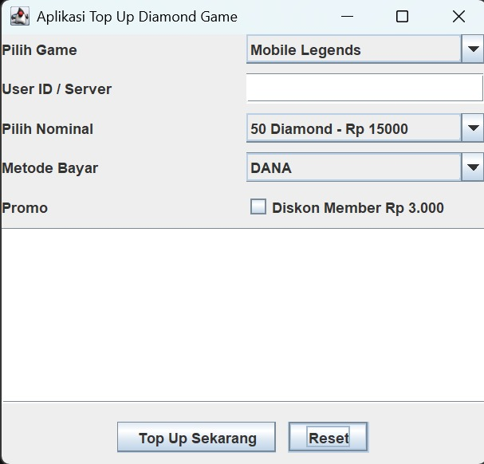
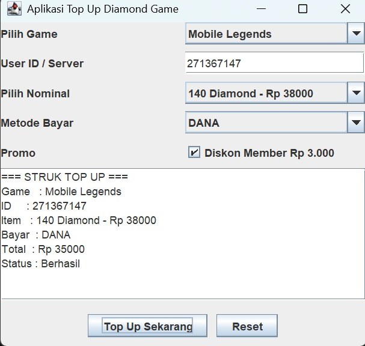
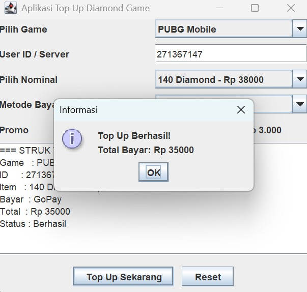

NAMA : Deswita Salsabila
NIM : F1D02410004

# Aplikasi Top Up Diamond Game 
Aplikasi desktop sederhana berbasis Java Swing untuk simulasi transaksi top-up diamond game dengan fitur pemilihan game, nominal item, metode pembayaran, diskon member, dan pencetakan riwayat struk.

## 5 Komponen Utama GUI yang Digunakan

1. **Top-level Container Class**
   - `javax.swing.JFrame`: Digunakan sebagai jendela utama aplikasi (`frame`).
   - `javax.swing.JOptionPane`: Digunakan untuk menampilkan dialog pop-up peringatan validasi input dan konfirmasi transaksi berhasil.

2. **Intermediate Container Class**
   - `javax.swing.JPanel`: Digunakan untuk mengelompokkan komponen form input (`panel1`) dan tombol aksi (`panel2`).
   - `javax.swing.JScrollPane`: Digunakan sebagai wadah pembungkus `JTextArea` (`scroll1`) agar riwayat struk transaksi dapat digulir (*scroll*).

3. **Atomic Component Class**
   - `javax.swing.JLabel`: Menampilkan label keterangan input (`label1` sampai `label5`).
   - `javax.swing.JTextField`: Kolom input teks untuk mengisi User ID dan Server (`text1`).
   - `javax.swing.JComboBox`: Menu pilihan dropdown untuk memilih jenis game, nominal diamond, dan metode pembayaran (`combo1`, `combo2`, `combo3`).
   - `javax.swing.JCheckBox`: Kotak centang untuk mengaktifkan promo diskon member (`check1`).
   - `javax.swing.JTextArea`: Area teks untuk menampilkan riwayat struk transaksi (`area1`).
   - `javax.swing.JButton`: Tombol interaktif untuk memproses transaksi dan mereset form (`btn1`, `btn2`).

4. **Layout Classes (3 Layout)**
   - `java.awt.BorderLayout`: Mengatur tata letak utama pada `contentPane` milik `JFrame` (`panel1` di `NORTH`, `scroll1` di `CENTER`, dan `panel2` di `SOUTH`).
   - `java.awt.GridLayout`: Mengatur posisi label dan komponen input di dalam `panel1` dalam format grid 5 baris x 2 kolom.
   - `java.awt.FlowLayout`: Mengatur posisi tombol di dalam `panel2` agar sejajar di tengah (`FlowLayout.CENTER`).

5. **Event Listener**
   - `java.awt.event.ActionListener`: Interface yang diimplementasikan pada `btn1` dan `btn2` dengan melakukan *override* pada method `actionPerformed(ActionEvent e)` untuk menangani aksi klik tombol.

## Screenshot Aplikasi

### Tampilan Awal

### Tampilan Struk Transaksi

### Tampilan Pop-up Konfirmasi
